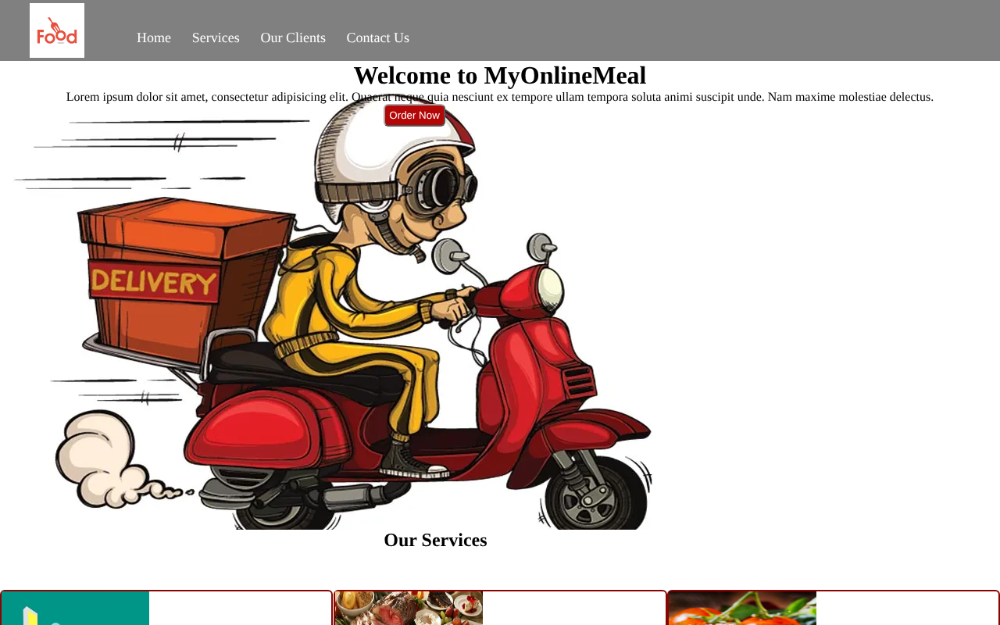
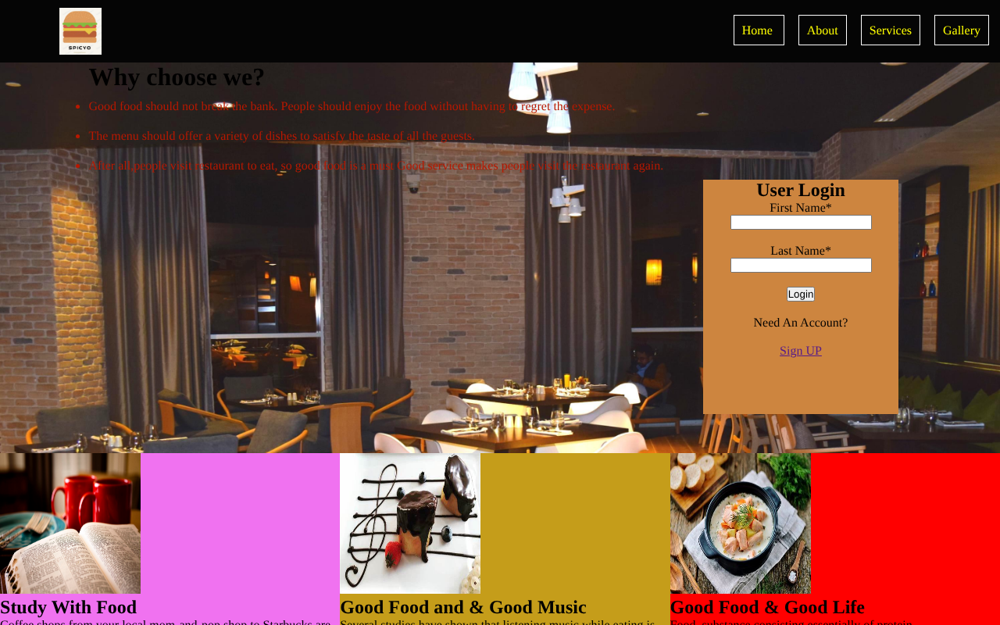
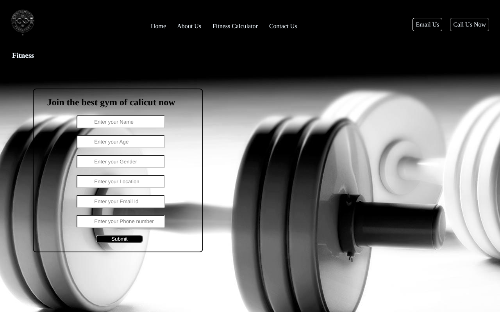

# Web Design Practice — HTML & CSS

Early front-end practice projects (2022): static, multi-section landing pages built with hand-written HTML and CSS, no frameworks.
Kept as an archive; my current focus is data and machine learning — see my [pinned repositories](https://github.com/ajay-narayan).


## Projects

| Project | What it practices | Preview |
|---------|-------------------|---------|
| [Online Food Delivery](online-food-delivery) | Nav bar, hero section, service cards, client section, contact form |  |
| [Restaurant Website](restaurant-website) | Full-bleed background, login panel, three-column feature grid |  |
| [Gym Website](gym-website) | Background imagery, header CTAs, membership sign-up form |  |
| [Food Landing](food-landing) | Minimal page scaffold | — |
| [CSS Basics](css-basics) | Selectors, external stylesheets, backgrounds | — |
| [HTML Practice](html-practice) | Tables, forms, lists, links | — |

## Run locally

No build step — open any `index.html` in a browser, or serve the folder:

```bash
git clone https://github.com/ajay-narayan/CSS.git
cd CSS
python -m http.server 8000   # then visit http://localhost:8000/online-food-delivery/
```
